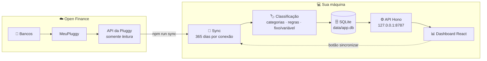

# 💸 openfinance

**Seu dashboard pessoal de gastos, rodando só na sua máquina.**

O openfinance lê sua conta corrente e seu cartão de crédito via Open Finance
(MeuPluggy + API da Pluggy, **somente leitura**), guarda tudo num SQLite local e mostra para
onde o dinheiro está indo direto no navegador. Nada sai do seu computador além das chamadas
de leitura para a Pluggy.

## ✨ O que ele faz

- 📊 **Gasto do mês** por categoria, com compras, estornos, receitas e transferências separados.
- 🏷️ **Categorias em pt-BR**, com regras locais (regex) e edição manual de cada transação.
- 🔁 **Gastos fixos x variáveis**, detectados automaticamente e ajustáveis por estabelecimento.
- 🧾 **Conferência das faturas**: a soma das compras de cada fatura tem que bater com o total.
- 🙈 **Modo "ocultar valores"** para abrir o dashboard sem expor números na tela.
- 🔒 **Local e somente leitura**: API presa em `127.0.0.1`, banco com permissão 600, nenhum
  endpoint de pagamento.

## 🗺️ Como funciona



1. **Sync** — para cada banco conectado, busca os últimos 365 dias e substitui as transações
   dessa janela. Rodar de novo é seguro: suas edições manuais são preservadas.
2. **Classificação** — separa o que é gasto do que é estorno, receita, transferência ou
   pagamento de fatura; aplica suas regras de categoria e a marcação fixo/variável.
3. **Dashboard** — a API lê do SQLite e o front mostra o mês, os gráficos e as transações.

Quer os detalhes? As decisões e os riscos estão em [docs/PLANO.md](docs/PLANO.md) e o
andamento de cada fase em [docs/PROXIMOS_PASSOS.md](docs/PROXIMOS_PASSOS.md).

## 🚀 Começando

### Do que você precisa

- **Node.js 22+** (o TypeScript roda direto com `tsx`, sem build do backend).
- Conta no [meu.pluggy.ai](https://meu.pluggy.ai) — gratuita para uso pessoal, até 5 conexões.
- Conta no [Dashboard da Pluggy](https://dashboard.pluggy.ai), para criar a aplicação.
- Recomendado: disco criptografado, já que `data/` guarda seu histórico financeiro.

### 1. Instale as dependências

```sh
npm install
```

### 2. Conecte seus bancos na Pluggy

1. No **meu.pluggy.ai**, conecte cada banco escolhendo sempre a opção **Open Finance**
   (nunca o conector que pede senha ou QR Code do banco).
2. No **Dashboard da Pluggy**, crie uma aplicação em *Applications* e anote o
   `CLIENT_ID` e o `CLIENT_SECRET`.
3. Ainda no Dashboard, use **Connect Account → MeuPluggy** e autorize. Cada banco conectado
   gera um `itemId`; anote todos.

> ⏳ A autorização do MeuPluggy vale **1 ano**. O dashboard avisa 30 dias antes de expirar;
> para renovar, é só repetir o *Connect Account* no Dashboard da Pluggy.

### 3. Configure o `.env`

```sh
cp .env.example .env
chmod 600 .env
```

Depois preencha:

| Variável | O que colocar |
|---|---|
| `PLUGGY_CLIENT_ID` | Client ID da aplicação no Dashboard da Pluggy |
| `PLUGGY_CLIENT_SECRET` | Client secret da mesma aplicação |
| `PLUGGY_ITEM_IDS` | Os `itemId`s do MeuPluggy, um por banco, separados por vírgula |
| `PORT` *(opcional)* | Porta da API; padrão `8787` |

> 🔐 O `.env` está no `.gitignore` e nunca deve ser commitado.

### 4. Sincronize

```sh
npm run sync
```

Na primeira vez, cria o `data/app.db` (permissão 600) e aplica as migrações. Depois busca os
últimos 365 dias de cada conexão e imprime só um resumo agregado: contagens, integridade das
faturas e validade do consentimento. Se alguma conexão falhar, as outras continuam e o
comando sai com código 1.

### 5. Abra o dashboard 🎉

```sh
npm run dashboard
```

Compila o front e sobe tudo em **<http://127.0.0.1:8787>**. O botão de sincronizar no
dashboard roda o mesmo sync do passo anterior.

## 🛠️ Desenvolvimento

| Comando | O que faz |
|---|---|
| `npm run api` + `npm run web:dev` | API em 8787 e Vite em <http://127.0.0.1:5173> (com proxy de `/api`) |
| `WEB_MOCK=1 npm run web:dev` | Front com dados sintéticos, sem API nem credenciais |
| `npm test` | Todos os testes (`node:test`) |
| `node --import tsx --test test/rules.test.ts` | Um arquivo de teste |
| `npm run typecheck` | `tsc` do backend e do front |
| `npm run spike` | Salva o JSON bruto da Pluggy em `data/raw/` (diagnóstico) |

> 💡 Quer só mexer no visual? `WEB_MOCK=1 npm run web:dev` não precisa de conta nem de `.env`.

## 🔒 Dados e privacidade

- Tudo fica em `data/` (fora do git): o `app.db` e, se usar o `spike`, `data/raw/`.
- O cliente da Pluggy só lê: o único POST é `/auth` e não há acesso a endpoints de pagamento.
- A API só escuta em `127.0.0.1`.
- Para revogar o acesso, remova a conexão no meu.pluggy.ai ou no app do banco.

## 🆘 Problemas comuns

| Sintoma | O que fazer |
|---|---|
| `Variável PLUGGY_... não definida` | O `.env` não existe ou está incompleto — volte ao passo 3. |
| Sync volta vazio ou com erro de consentimento | A autorização expirou: refaça o *Connect Account → MeuPluggy* no Dashboard da Pluggy. |
| As transações de ontem não aparecem | Normal: o MeuPluggy atualiza uma vez a cada 24 h (D+1). |
